<div align="center">

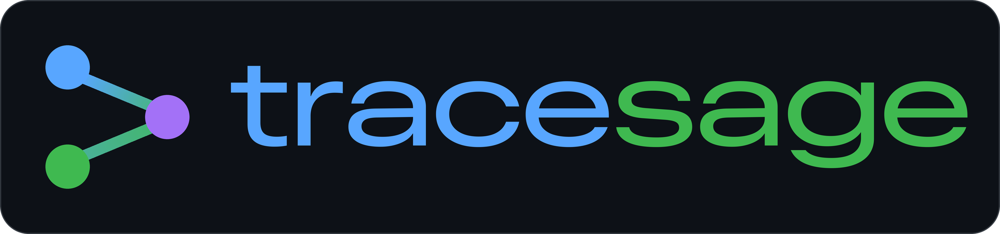

# tracesage

**See what your LLM agents, and the AI assistants you use every day, actually did.**
Local-first observability for LangChain / LangGraph, Pydantic AI, OpenAI Agents SDK, CrewAI
and any OpenTelemetry source — drop in one line, watch every run live in your browser.
Or run `tracesage connect` and see every Claude Desktop, Claude Code, Cursor and Codex
session as a full trace.

[](https://pypi.org/project/tracesage/)
[](https://pypi.org/project/tracesage/)
[](LICENSE)
[](https://github.com/kjgpta/tracesage/actions/workflows/ci.yml)
[](https://kjgpta.github.io/tracesage/)
[](#status)

<a href="docs/assets/tracesage-demo.mp4">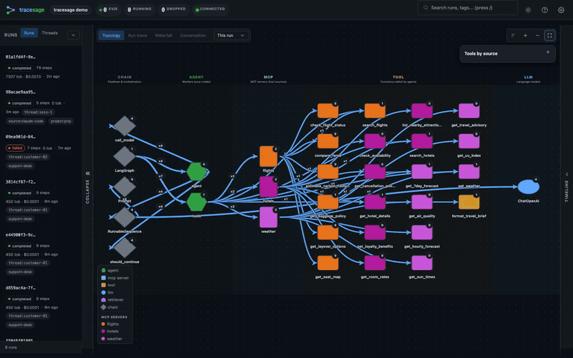</a>

<sub><a href="docs/assets/tracesage-demo.mp4">▶ Watch the full 1-minute demo</a></sub>

</div>

### Try it in 30 seconds

```bash
pip install tracesage          # demo needs no LangChain extra
tracesage demo                 # seeds a sample run and opens the live UI
```

No API key, no config, no code. `tracesage demo` opens a real trace so you can click
around the graph immediately. To trace your own agent, install the LangChain extra
and wrap the call:

```bash
pip install "tracesage[langchain]"
```

```python
import tracesage

with tracesage.trace():          # starts the local UI and captures this process
    result = agent.invoke("your input")
# tracesage prints a link: 🔍 http://127.0.0.1:7842/ui
```

Not on LangChain? Same one line, name the framework:

```python
with tracesage.trace(instrument=["pydantic_ai"]):     # or openai_agents, crewai, openai, anthropic
    agent.run_sync("your input")
```

### Works with

| Framework | How | Install |
|---|---|---|
| **LangChain / LangGraph** | callback handler (native) | `pip install "tracesage[langchain]"` |
| **Pydantic AI** | `instrument=["pydantic_ai"]` | `pip install "tracesage[pydantic-ai]"` |
| **OpenAI Agents SDK** | `instrument=["openai_agents"]` | `pip install "tracesage[openai-agents]"` |
| **CrewAI** | `instrument=["crewai"]` | `pip install "tracesage[crewai]"` |
| **OpenAI / Anthropic clients** | `instrument=["openai"]` / `["anthropic"]` | `pip install "tracesage[openai]"` / `"tracesage[anthropic]"` |
| **Any OpenTelemetry source** (other process / language) | `tracesage serve --ingest` + `OTEL_EXPORTER_OTLP_ENDPOINT` | `pip install "tracesage[otel]"` |
| **Plain Python** | `tl.span(...)` / `@tl.trace_fn(...)` | `pip install tracesage` |

Details, span mapping and per-framework notes: [docs/frameworks.md](docs/frameworks.md).

| AI assistant | How | Install |
|---|---|---|
| **Claude Desktop** (chats and Cowork), **Claude Code**, **Cursor**, **Codex** (CLI, IDE, ChatGPT desktop) | `tracesage connect` | `pip install "tracesage[apps]"` |

See [Use it with your AI assistants](#use-it-with-your-ai-assistants).

<div align="center">
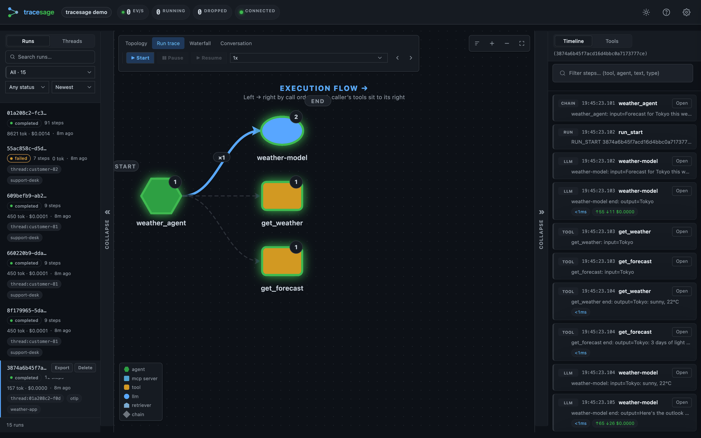
<br><sub>A Pydantic AI run arriving over OTLP — same graph, timeline and token counts as a LangChain run.</sub>
</div>

### When a run breaks, see exactly where

A failed tool call shows up as a **red node on the exact step that broke** — the tool,
its input, and the error — instead of a stack trace buried in your logs.

<div align="center">
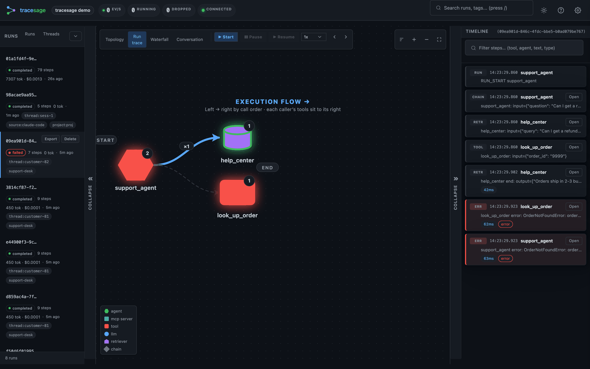
</div>

---

## Contents

- [Why tracesage](#why-tracesage)
- [Use it with your AI assistants](#use-it-with-your-ai-assistants)
- [Install](#install)
- [Quick start](#quick-start)
- [Screenshots](#screenshots)
- [Concepts: topology node kinds](#concepts-topology-node-kinds)
- [Features](#features)
- [Examples](#examples)
- [Documentation](#documentation)
- [Comparison](#comparison)
- [Performance](#performance)
- [Status](#status)
- [Contributing](#contributing)
- [License](#license)

---

## Why tracesage

LangChain agents emit a rich callback stream — chain start/end, tool start/end,
LLM start/end, retrieval, errors — and every other major agent framework emits the
same story as OpenTelemetry spans. **tracesage** captures all of it without
changing your workflow logic, persists it locally (SQLite + gzipped blobs),
and renders it in an interactive graph + timeline UI in real time.

- **Zero infrastructure.** No Docker. No Postgres. No external services. `pip install`.
  The UI is fully self-contained (assets vendored, no CDN) and works offline.
- **Minimal-change integration.** Add one callback to your existing `ainvoke` — no rewrites.
- **Crash-safe by design.** The handler never raises and the tracer never crashes
  your pipeline.
- **Interactive graph view.** Custom SVG graph (no framework), auto-laid-out. Hover, click, replay any run.
- **MCP-aware.** Tools loaded from MCP servers are attributed by source, so you can
  see which tools came from which server vs. which are hardcoded. See [docs/mcp.md](docs/mcp.md).
- **Framework-agnostic via OpenTelemetry.** Pydantic AI, OpenAI Agents SDK, CrewAI and the
  OpenAI / Anthropic clients plug in with `instrument=[...]`; anything else that speaks OTLP
  can post to `tracesage serve --ingest`. See [docs/frameworks.md](docs/frameworks.md).
- **OpenTelemetry export.** Optionally ship every trace as OTel spans to your collector /
  Tempo / Jaeger / Datadog / Honeycomb — the bridge from the local dev view to your
  production stack (config-driven; see [docs/configuration.md](docs/configuration.md#opentelemetry-export)).
- **Multi-app friendly.** Run several apps at once: each auto-binds a free port (7842, 7843, …),
  shows its `TRACESAGE_PROJECT_NAME` in the UI header, and keeps its own data dir — no clashes.
- **Pluggable storage.** SQLite and gzipped blobs behind a `StorageBackend` protocol, so another backend can be added (see [docs/extending.md](docs/extending.md)).
- **Apache 2.0 licensed.** Free forever.

## Use it with your AI assistants

If Claude Code, Cursor, Codex or Claude Desktop is already installed, connect that
app and its sessions show up in the tracesage UI. One install covers every app;
`tracesage connect` with no name connects all of them, and a name connects just
that one.

```bash
pip install "tracesage[apps]"      # or: uv tool install "tracesage[apps]"
```

### Claude Code

```bash
tracesage connect claude-code
```

Restart Claude Code if it was already open, so it loads the hook. Open
<http://127.0.0.1:7842>, leave the list on **Runs**, and set **Source** to
Claude Code. Sessions already on disk (`~/.claude/projects`) are imported on
first start. Send a new prompt, and that turn appears a few seconds after Claude
Code writes it. Click the run: **Run trace** shows each model request, each tool
call and each subagent, and the timeline on the right has the full input and
output of every step. Guide: [Claude Code](docs/apps/claude-code.md).

### Cursor

```bash
tracesage connect cursor
```

Restart Cursor if it was open. In the UI set **Source** to Cursor. Agent chats
from the last 30 days are imported from Cursor's local database, and new ones
appear as you send them. Guide: [Cursor](docs/apps/cursor.md).

### Codex

```bash
tracesage connect codex
```

Then, once, inside Codex: run `/hooks` and trust the tracesage hooks. In the UI
set **Source** to Codex. This covers the Codex CLI, the IDE extension, and Codex
inside the ChatGPT desktop app. Ordinary ChatGPT chats are not on disk in a
form tracesage can read. Guide: [Codex](docs/apps/codex.md).

### Claude Desktop

Recording needs no change inside Claude Desktop. The collector reads the chats
and Cowork sessions Desktop has saved on this machine:

```bash
tracesage connect claude-desktop          # record sidebar chats and Cowork
tracesage connect claude-desktop --mcp    # optional: let Claude query your traces
```

In the UI switch to **Threads** and set **Source** to Claude Desktop. A chat
shows up once you have opened it in Desktop on this computer. The Code tab is
Claude Code, so connect `claude-code` for those sessions. Guide:
[Claude Desktop](docs/apps/claude-desktop.md).

`connect` installs a collector on `127.0.0.1:7842` that starts again at login,
shows you each file it will change, and keeps a backup. `tracesage connect
--status` reports which apps are connected and the last run seen from each.
`tracesage disconnect` puts the changed files back. Every turn becomes a trace
of what the assistant did underneath: each model request (named by the model,
with thinking and tokens), each tool call, and each subagent nested under the
call that spawned it. Nothing leaves your machine.

<div align="center">
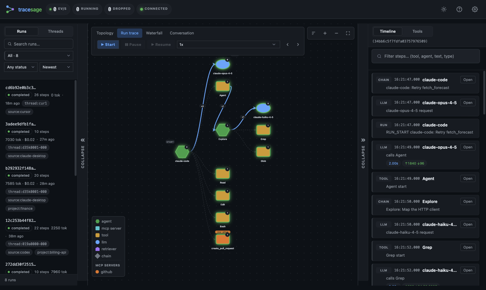
</div>

What you can do with it:

- **See everything behind one answer**: every model call, tool call and subagent,
  with full input and output.
- **Find the slow or failing step** in the waterfall.
- **Read a whole chat** in the Threads tab, and jump from any turn to its trace.
- **Search across every assistant** at once: prompts, replies, tool output, errors.
- **Filter and sort** by app, status, chat length, steps, tokens or cost.
- **See which tools and MCP servers** each run used.
- **Ask Claude about its own traces** over MCP.

More: [AI apps](docs/ai-apps.md), [Using the UI](docs/apps/using-the-ui.md),
[Privacy and data](docs/apps/privacy-and-data.md).

## Install

```bash
pip install tracesage
```

The base install is the debugger: UI, search, waterfall, conversations, hooks
and the collector, with no pricing or MCP client library. Add an extra when you
need one:

| Extra | What it adds |
|---|---|
| `tracesage[langchain]` | LangChain / LangGraph callback handler |
| `tracesage[pricing]` | Dollar costs (`genai-prices`, offline) |
| `tracesage[apps]` | `tracesage connect`, `tracesage mcp`, and dollar costs |
| `tracesage[mcp]` | LangChain MCP tool-source attribution |
| `tracesage[otel]` | `tracesage serve --ingest` as a standalone collector |
| `tracesage[pydantic-ai]` and the other framework extras | One-line `instrument=[...]` |

```bash
pip install "tracesage[langchain]"
```

Requires **Python 3.11+**. Quote the extra (`"tracesage[langchain]"`) so zsh —
the default macOS shell — doesn't glob the brackets and fail with `no matches
found`. The `[langchain]` extra pulls `langchain-core`; that's the only mandatory
third-party dep beyond the standard FastAPI / aiosqlite / pydantic stack. If your
app uses **LangGraph**, also `pip install langgraph` (tracesage doesn't pull it).

tracesage is **provider-agnostic** — it traces LangChain's callback stream, so
OpenAI / Anthropic / local models are all captured automatically; there's no
provider setting in tracesage. Install whichever provider you use:

```bash
pip install langchain-openai      # OPENAI_API_KEY=...
pip install langchain-anthropic   # ANTHROPIC_API_KEY=...
```

For MCP tool-source attribution (loads tools from MCP servers and tags them by
source), install the `mcp` extra:

```bash
pip install 'tracesage[mcp]'
```

For non-LangChain frameworks pick the matching extra — `pydantic-ai`, `openai-agents`,
`crewai`, `openai`, `anthropic` (each pulls the OpenTelemetry SDK and that framework's
instrumentor; the framework itself is not pinned) — or `otel` to run
`tracesage serve --ingest` as a standalone OTLP collector:

```bash
pip install "tracesage[pydantic-ai]"
```

## Quick start

**See it in 5 seconds** — seed a sample trace and open the UI:

```bash
tracesage demo
```

**Sync scripts / notebooks** — wrap your code; every LangChain call is captured
automatically (no `callbacks=` wiring) and a clickable trace link is printed:

```python
import tracesage

with tracesage.trace() as tl:          # starts the UI + global capture
    result = agent.invoke("your input")     # 🔍 tracesage: http://127.0.0.1:7842/ui/#run=...
    input("Trace ready — open the printed link, then Enter to exit.")  # keep the UI up
```

(The embedded UI stops when the `with` block / process exits; traces persist to
`~/.tracesage`, so you can also reopen them later with `tracesage serve`.)

**Async apps** — use the context manager (or `await TraceSage.create()` for full control):

```python
import asyncio
from tracesage import TraceSage

async def main():
    async with TraceSage.session(install=True) as tl:   # install=True → global capture
        await graph.ainvoke({"input": "your payload"}, config={"tags": ["my-system"]})
        await tl.flush()                                 # ensure events are persisted
        print(tl.run_url("<run_id>"))                    # deep link to a run

asyncio.run(main())
```

Prefer explicit wiring? Pass `config={"callbacks": [tl.handler]}` instead of `install=True`.

That's it. Open the URL tracesage prints on startup (`🔍 tracesage: http://…/ui/#run=…`)
and explore — it's **http://localhost:7842/ui** by default, but auto-port picks the next
free port (`7843`, …) if `7842` is taken, so trust the printed link (`tracer.ui_url`).

### Developer workflow

Once you have traces, debug them without leaving your terminal:

```bash
tracesage show <run_id>          # render a run as a tree in the terminal
tracesage watch <run_id>         # live-tail events as they stream
tracesage diff <run_a> <run_b>   # compare two runs (tokens, tools, errors)
tracesage view trace.jsonl       # open an exported trace in the UI directly
```

**Test your agents** — the `tracesage_capture` pytest fixture is auto-registered:

```python
def test_agent_uses_search(tracesage_capture):
    agent.invoke("find me a hotel")
    tracesage_capture.assert_tool_called("search")
    tracesage_capture.assert_no_errors()
    assert tracesage_capture.total_tokens()[0] < 5000
```

See **[`docs/development.md`](docs/development.md)** for the full developer guide, and
**[`examples/showcase/`](examples/showcase/)** for 30 before/after apps across popular use cases.

## Screenshots

<table>
  <tr>
    <td width="50%">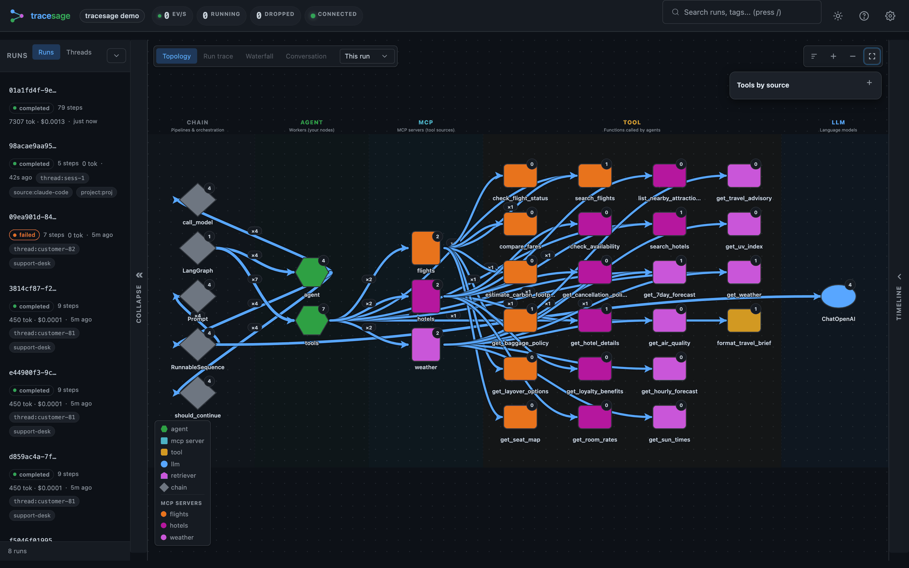</td>
    <td width="50%">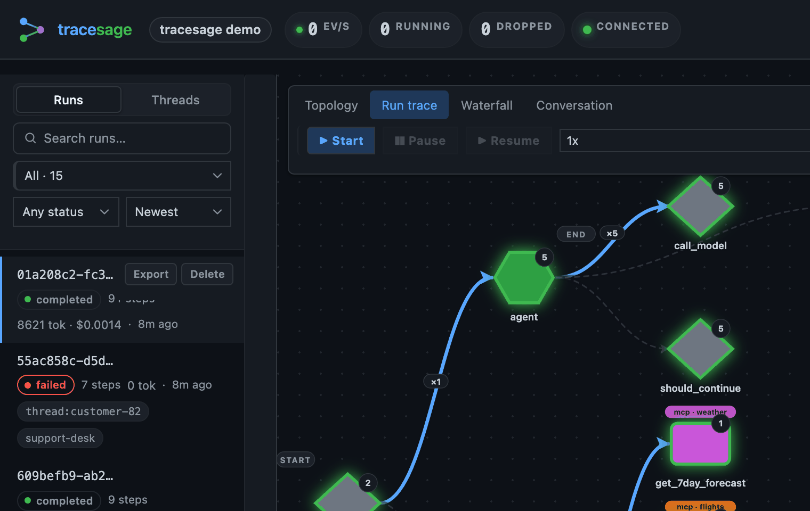</td>
  </tr>
  <tr>
    <td align="center"><em>Live topology — agents, tools, LLMs and MCP servers across a run.</em></td>
    <td align="center"><em>Run list — source, status and sort filters, with <strong>green completed, red failed</strong>.</em></td>
  </tr>
  <tr>
    <td width="50%">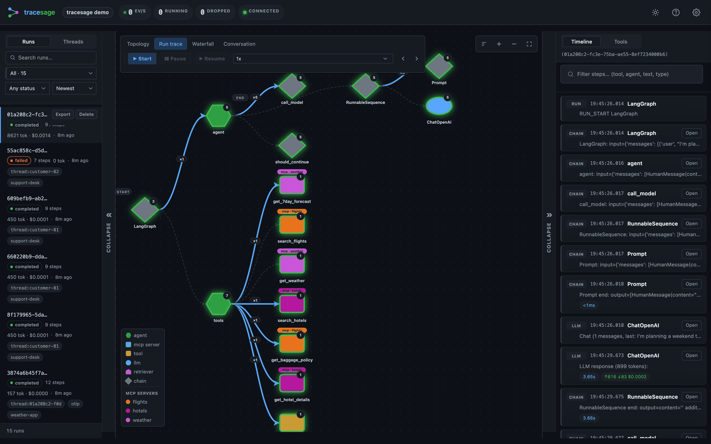</td>
    <td width="50%">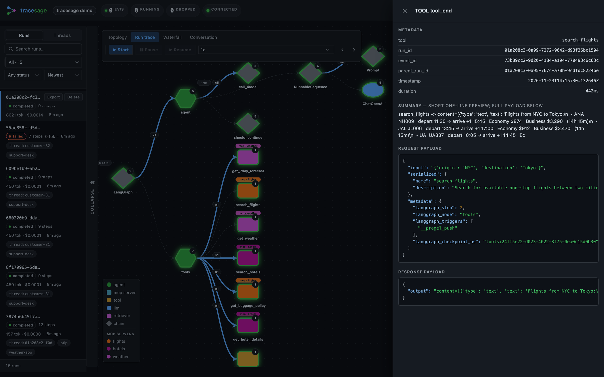</td>
  </tr>
  <tr>
    <td align="center"><em>Run trace — the path a run took, with a step-by-step timeline you can replay.</em></td>
    <td align="center"><em>Click any step for its full <strong>request and response</strong> payloads, tokens and errors.</em></td>
  </tr>
  <tr>
    <td width="50%">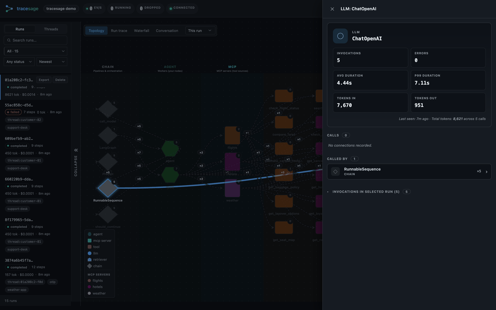</td>
    <td width="50%">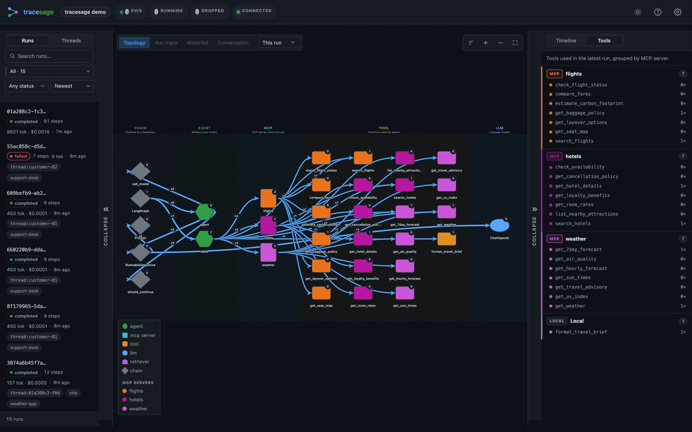</td>
  </tr>
  <tr>
    <td align="center"><em>Inspect an <strong>LLM</strong> — token usage (in / out, total across calls) and latency.</em></td>
    <td align="center"><em>The Tools tab in the side panel — every tool grouped by origin (MCP servers vs. local).</em></td>
  </tr>
  <tr>
    <td width="50%"></td>
    <td width="50%">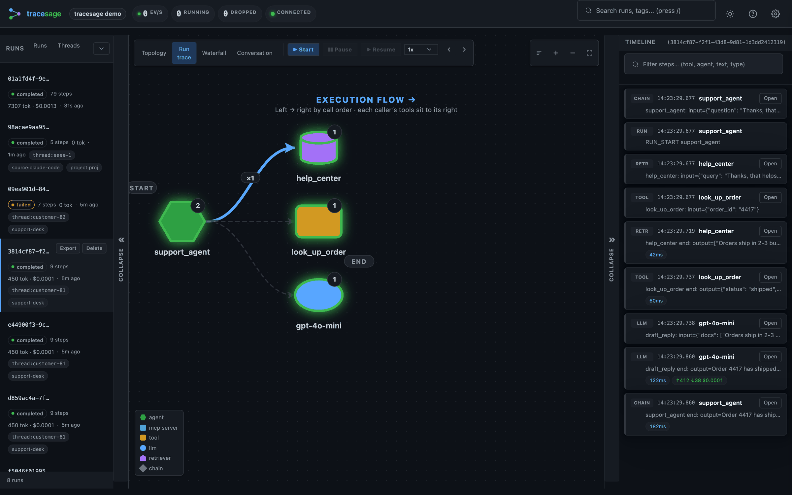</td>
  </tr>
  <tr>
    <td align="center"><em>Any <strong>OpenTelemetry</strong> source — here a Pydantic AI agent via <code>serve --ingest</code>.</em></td>
    <td align="center"><em>Plain Python with <code>tl.span</code> / <code>@tl.trace_fn</code> — agent, retriever, tool and LLM spans.</em></td>
  </tr>
  <tr>
    <td width="50%">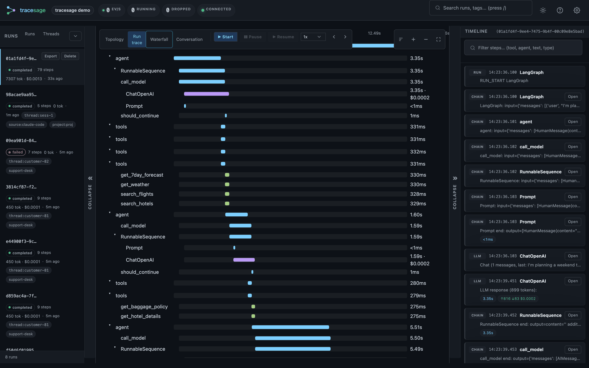</td>
    <td width="50%">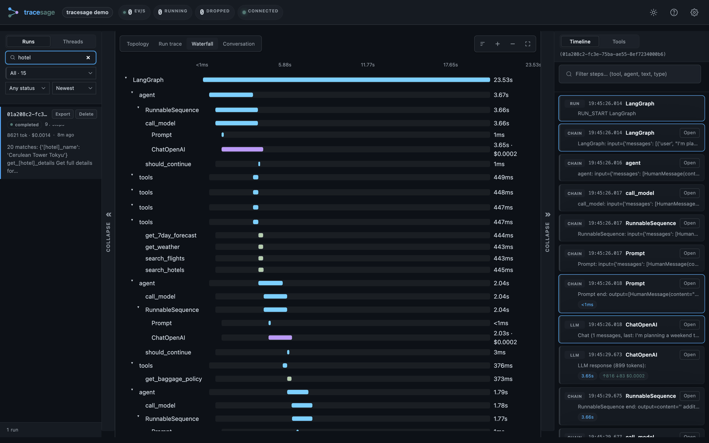</td>
  </tr>
  <tr>
    <td align="center"><em>Waterfall — which step took the time, with token cost on the model calls.</em></td>
    <td align="center"><em>Search across prompts and tool output, with matching steps highlighted.</em></td>
  </tr>
  <tr>
    <td width="50%">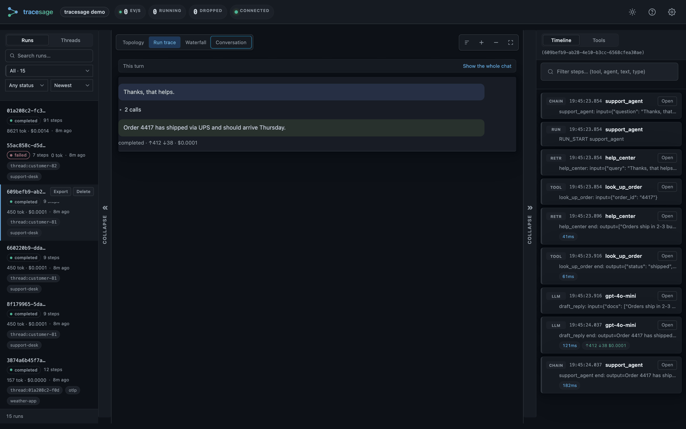</td>
    <td width="50%">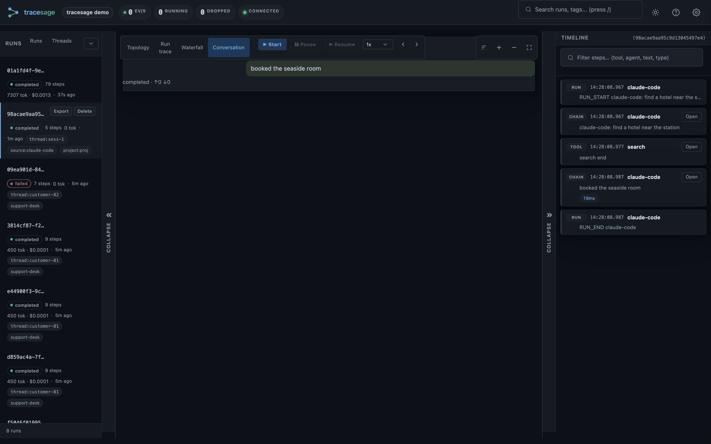</td>
  </tr>
  <tr>
    <td align="center"><em>Conversation — a thread as chat, with the tools each turn called.</em></td>
    <td align="center"><em>A Claude Code chat from the Threads view, imported by <code>tracesage connect</code>.</em></td>
  </tr>
</table>

## Concepts: topology node kinds

When you open the UI, every node in the topology graph is one of five event-based
kinds — plus a synthesized **`mcp`** node when you attribute tools to an MCP server.
Knowing what each means is the prerequisite to reading a trace:

| Kind | What it is | Examples you'll see |
|---|---|---|
| **`agent`** | A function **you** registered as a LangGraph node, that calls other components | `agent:billing_agent`, `agent:fact_extractor`, `agent:supervisor` |
| **`tool`** | A side-effect function (DB query, API call, calculation) decorated with `@tool` | `tool:lookup_account`, `tool:run_sql`, `tool:cite_sources` |
| **`llm`** | A language-model call (chat or completion) | `llm:FakeListChatModel`, `llm:ChatOpenAI`, `llm:ChatAnthropic` |
| **`retriever`** | A `BaseRetriever` subclass — the "R" in RAG | `retriever:Chroma`, `retriever:FAISS`, `retriever:_FixedCorpusRetriever` |
| **`chain`** | Plumbing — LCEL primitives, the LangGraph orchestrator, routing functions | `chain:LangGraph`, `chain:RunnableSequence`, `chain:ChatPromptTemplate`, `chain:route_after_quality` |
| **`mcp`** | An MCP server (synthesized) — groups the tools loaded from it | `mcp:weather`, `mcp:math`, `mcp:github` |

Quick mental model:

- **`agent`** is your code that *calls* something. It does reasoning.
- **`tool`** does the actual side-effect work and returns a result.
- **`llm`** is what you count, cost, and cache.
- **`retriever`** is its own dimension — "did we find the right docs?"
  is a different question from "did the LLM use them well?".
- **`chain`** is the wrapping machinery (the `prompt | llm | parser`
  pipe operator, the LangGraph state machine, routing functions). It's
  infrastructure, not business logic.
- **`mcp`** groups tools by the MCP server they came from — provenance, so you can
  tell server-provided tools from your hardcoded ones (see [docs/mcp.md](docs/mcp.md)).

Read the full reference at **[`docs/concepts.md`](docs/concepts.md)** —
it covers how tracesage classifies events into kinds, why agents with no
descendants get demoted to `chain`, and walks through a research-pipeline
topology piece by piece.

## Features

### Live interactive UI

- **Run list** with status badges (running / completed / failed), search, and a
  **toast** when a watched run finishes ("Run completed" / "Run failed: …")
- **Runs | Threads** — Runs lists single turns; Threads lists whole conversations and
  shows them as chat, with an **Open run** link on each turn. Each tab has its own
  filters next to the search box: source (an AI app or your own agents), status or
  minimum turns, and sort by newest, steps, tokens or cost
- **Resizable panes** — drag the edges of the run list and the side panel (widths are
  remembered), or collapse either one; a spinner shows while the next run or thread loads
- **Topology vs. Run-trace** — one graph pane toggles between the all-up system
  architecture (nodes in per-kind columns) and a single run laid out as a left → right
  call tree in call order. Picking a run opens its trace; the Topology button returns.
- **Step-through replay** — explicit **Start / Pause / Resume** plus **Prev / Next**
  manual stepping walk a run on the graph (1x / 2x / 5x); clicking a timeline step during
  replay pauses and jumps the cursor there
- **Scoped topology** — the graph + the Tools tab default to the *selected run*
  (a toolbar selector switches to last-N-runs / all-time), so removed tools, agents, or
  MCP servers don't linger across app versions as you iterate
- **MCP attribution** — `mcp:` server nodes with **distinct per-server colors** (tools
  tinted by source), agent→server and server→tool edges, and a "Tools" tab in the right
  pane listing tools by source; a large tool fan-out wraps into columns and the graph caps its zoom so nodes stay
  legible instead of shrinking to fit
- **Timeline** with click-to-expand step cards — a `*_start` shows its **request**, a
  `*_end` the full **request + response** payloads, plus tokens, duration, and errors;
  MCP-backed tools are tagged with their server
- **Node inspector** — click any node for its stats; LLM nodes show **token usage**
  (in / out, total across N calls) and each node's invocations are grouped one-per-call
- **Header stats** — `ev/s` (1-min rolling event rate), `running` (in-progress runs),
  `dropped` (events lost to backpressure; red if non-zero), and a heartbeat-backed
  connection dot that reflects a dropped link instead of going stale
- **Dark / light themes**, persisted in `localStorage`
- **Keyboard shortcuts:** `j`/`k` next/prev run, `/` focus search, `t` toggle theme, `Esc`, `?`

### Production safety

- Refuses to bind non-loopback addresses without `auth_token` (hard fail-stop)
- Bearer-token HTTP auth + WebSocket auth via `?token=` or subprotocol
- Constant-time token comparison
- Path-traversal blocked at runtime
- Per-run event cap (circuit breaker) and root-level sampling for high volumes
- Bounded internal state (no unbounded memory growth in long-running processes)
- **Kill switch:** `TRACESAGE_ENABLED=false` makes it a complete no-op (no server, no
  DB/worker, no-op handler) — integrate once, disable per-environment. See
  [docs/production.md](docs/production.md).

### OpenTelemetry export (bridge to production)

tracesage's own UI/CLI is the **local developer-loop** view. To get agent traces into a
**production observability stack**, point `otlp_endpoint` at any OTLP/HTTP collector —
every trace is *also* emitted as OpenTelemetry spans (the local SQLite store stays too):

```bash
pip install "tracesage[otel]"
export TRACESAGE_OTLP_ENDPOINT=http://localhost:4318      # or set in TraceSageConfig
```

```python
from tracesage import TraceSageConfig
# pass to TraceSage.create() / .session() / tracesage.trace():
cfg = TraceSageConfig(otlp_endpoint="http://localhost:4318", otlp_service_name="my-agent")
```

**Where it helps:** the spans land in whatever OTLP-compatible backend you already run —
**Grafana Tempo, Jaeger, Datadog, Honeycomb, Arize/Phoenix, an OTel Collector** — so agent
traces sit alongside the rest of your services (correlated with HTTP/DB spans, long-term
retention, alerting, multi-service/multi-process views) with **no vendor lock-in**. Mapping:
`root_run_id`→trace, `run_id`→span, `parent_run_id`→parent; tokens/errors/MCP server become
span attributes. Best-effort — if the collector is down, tracing continues and your app is
never affected.

> **Note — it's config-driven, not a UI toggle.** There's no button in tracesage's UI to
> turn this on. You enable it via config/env *before* tracing starts, and the exported
> traces appear in **your OTel backend's** UI (Grafana/Jaeger/Datadog/…), not in
> tracesage's own UI. tracesage's UI always shows the local SQLite view. See
> [docs/configuration.md](docs/configuration.md#opentelemetry-export).

### OpenTelemetry ingest (other frameworks, other processes)

The same bridge runs in reverse. In-process, `instrument=[...]` on
`tracesage.trace()` / `start()` / `session()` routes a framework's OTel spans straight
into tracesage with no network hop. Across processes, `tracesage serve --ingest` is an
OTLP/HTTP collector (`POST /v1/traces`, protobuf or JSON, gzip, token-gated):

```bash
tracesage serve --ingest --open                         # collector + UI on :7842
OTEL_EXPORTER_OTLP_ENDPOINT=http://127.0.0.1:7842 python my_pydantic_ai_app.py
```

Spans are classified by the GenAI / OpenInference semantic conventions (`chat`,
`execute_tool`, `invoke_agent`, …) into the same topology kinds, tokens and errors roll up
to the run, and event ids derive from span ids so exporter retries are idempotent. Events
that arrived as OTel are not re-exported, so export and ingest cannot loop.
[docs/frameworks.md](docs/frameworks.md) has the full mapping.

### Manual spans (no framework)

```python
with tracesage.trace() as tl:
    with tl.span("pipeline", kind="agent") as root:
        with tl.span("fetch", kind="tool", tool_name="web_search") as s:
            s.set_output(search("..."))
        with tl.span("summarise", kind="llm", model="gpt-4o") as llm:
            llm.set_output(text).set_tokens(input=1200, output=180)

@tl.trace_fn(kind="tool", tool_name="lookup")
def lookup(order_id: str) -> dict: ...
```

Spans nest by Python context (sync and `async with`), errors are recorded and
re-raised, and a LangChain call inside a manual span becomes its child.

### CLI

The `tracesage` command ships with the package — a **viewer + utilities** over a
data directory. It does not ingest events unless you ask it to: `tracesage serve --ingest`
runs an OTLP collector; otherwise ingestion happens only when your code calls
`TraceSage.create()`. The fastest way to see it working, with zero code:

```bash
tracesage demo                                    # seed a sample trace, serve + open the UI
```

**Inspect traces in the browser:**

| Command | What it does |
|---|---|
| `tracesage serve -d ~/.tracesage [--open]` | Read-only viewer over an existing data dir (auto-picks the next free port; `--auth-token` to gate it) |
| `tracesage serve --ingest -d DIR` | Same, plus an OTLP/HTTP collector on `POST /v1/traces` for Pydantic AI / OpenAI Agents / CrewAI / any OTel exporter |
| `tracesage view trace.jsonl [--open]` | Open an exported JSONL trace directly in the UI |

**Inspect traces in the terminal (no server):**

| Command | What it does |
|---|---|
| `tracesage runs -d DIR --status failed --limit 20` | List root runs (filter by `--status` / `--tag` / `--thread`, `--json` for NDJSON) |
| `tracesage show -d DIR <run_id>` | Render a run as a colour-coded indented call tree (MCP tools tagged `mcp:<server>`) |
| `tracesage watch -d DIR <run_id>` | Live-tail a run's events as they're written (`--once` to print and exit) |
| `tracesage diff -d DIR <run_a> <run_b>` | Compare two runs side by side — status, steps, tokens, tools, errors |
| `tracesage stats -d DIR [--json]` | Summary stats — run counts by status, avg duration, token totals, DB size |

**Move, retain, diagnose:**

| Command | What it does |
|---|---|
| `tracesage export -d DIR [RUN_ID] --all -o trace.jsonl` | Dump one run or `--all` to JSONL. Structured fields only — gzipped payloads are not included |
| `tracesage import -i trace.jsonl -d DIR` | Read a JSONL export back into a data dir. Copy `data_dir` itself when you also need the payload blobs |
| `tracesage gc --max-runs 10000 [--dry-run]` | Retention — delete oldest runs/blobs beyond a count or `--max-blob-size-gb` |
| `tracesage doctor -d ~/.tracesage` | Read-only diagnostics — schema version, run counts, orphan/missing-blob checks |
| `tracesage version` | Print the installed version |

Most commands take `--data-dir, -d` (default `~/.tracesage`). See
[`docs/cli.md`](docs/cli.md) for the full per-command reference.

## Examples

The [`examples/`](examples/) directory has four tiers:

- **[`getting_started/`](examples/getting_started/)** — 3 standalone demos driven by
  `FakeListChatModel` (**no API key**): smart-search agent, research supervisor, RAG.
- **[`frameworks/`](examples/frameworks/)** — one script per non-LangChain framework:
  Pydantic AI (`TestModel`, **no API key**), OpenAI Agents SDK, CrewAI, the OpenAI and
  Anthropic clients, the manual span API (**no API key**), and a `serve --ingest` recipe.
- **[`mcp/`](examples/mcp/)** — MCP attribution demos (needs `tracesage[mcp]`), including
  two real-world before/after apps:
    - **[`trip_demo/`](examples/mcp/trip_demo/)** — one agent over **three** bundled stdio
      MCP servers (flights / weather / hotels, 7 tools each) + a local tool; **no external
      installs**, just an LLM key. Best place to see multi-server topology + the Tools tab.
    - **[`gmail_youtube_demo/`](examples/mcp/gmail_youtube_demo/)** — a ReAct agent that reads
      a real Gmail inbox and summarises YouTube transcripts (YouTube needs no auth; Gmail is
      optional, via Google ADC).
- **[`showcase/`](examples/showcase/)** — **30 real before/after apps** across popular use
  cases (customer support, RAG, multi-agent, MCP, reasoning loops, finance/legal/insurance).
  Each ships a plain `before.py` and an `after.py` with tracesage added, so `diff` shows the
  exact integration.

```bash
# instant, no key:
python examples/getting_started/01_smart_search_agent.py       # then open http://localhost:7842/ui
python examples/frameworks/pydantic_ai_agent.py                # Pydantic AI, no key either

# the real-world gallery (needs an LLM key):
pip install -r examples/showcase/requirements.txt
export OPENAI_API_KEY=...
python examples/showcase/01_support_faq_router/after.py
```

The **[showcase gallery](examples/showcase/)** has 30 before/after apps spanning
LangChain + LangGraph: routing, parallel fan-out, the supervisor pattern, RAG variants,
writer-critic loops, map-reduce, MCP, self-correction, and finance/legal/insurance verticals.

## Documentation

| Doc | What's in it |
|---|---|
| [Quickstart](docs/quickstart.md) | First trace in five minutes |
| [AI apps](docs/ai-apps.md) | Record Claude Desktop, Claude Code, Cursor and Codex sessions; what you can do with them |
| [Claude Desktop](docs/apps/claude-desktop.md) | Step by step, including asking Claude about your traces over MCP |
| [Using the UI](docs/apps/using-the-ui.md) | Runs and Threads, search and filters, the Tools tab, shortcuts |
| [Privacy and data](docs/apps/privacy-and-data.md) | What is stored, metadata-only mode, deleting and uninstalling |
| [Developer guide](docs/development.md) | Trace links, sync/notebook setup, CLI debugging, pytest fixture |
| [Frameworks](docs/frameworks.md) | Pydantic AI, OpenAI Agents SDK, CrewAI, OpenAI/Anthropic, OTLP ingest, manual spans |
| [Configuration](docs/configuration.md) | Every `TRACESAGE_*` env var explained |
| [CLI reference](docs/cli.md) | All `tracesage` subcommands |
| [Production guide](docs/production.md) | Sampling, auth, retention, deployment |
| [Troubleshooting](docs/troubleshooting.md) | "Where are my runs?", install/port issues, FAQ |
| [Comparison](docs/comparison.md) | tracesage vs LangSmith / Langfuse / Phoenix / MLflow |
| [Extending tracesage](docs/extending.md) | Adding framework adapters and storage backends |
| **[Examples](examples/showcase/)** | **30 before/after apps with tracesage added** |

## Comparison

When to use `tracesage` vs alternatives:

| | tracesage | LangSmith | Langfuse | Phoenix |
|---|---|---|---|---|
| Zero infra | ✓ | cloud / Enterprise self-host | Postgres + ClickHouse + Redis + S3 | ✓ |
| Pure pip install | ✓ | ✓ (cloud) | ✗ | ✓ |
| Live LangGraph topology | ✓ | ✓ (Studio) | agent graph view | span tree |
| MCP tool → server attribution | ✓ | ✗ | ✗ | ✗ |
| HITL interrupts shown as paused | ✓ | ✓ (Studio) | — | ✗ |
| License | Apache 2.0 | proprietary | MIT core | Elastic 2.0 |
| Evals / prompt playground | non-goal | ✓ | ✓ | ✓ |
| OpenTelemetry | ingest + export (GenAI semconv) | ingest | ingest | ingest + export |
| Frameworks | LangChain native; Pydantic AI / OpenAI Agents / CrewAI / OpenAI / Anthropic via OTel | all | all | all |

See [`docs/comparison.md`](docs/comparison.md) for the full breakdown.

## Performance

Bench results (5,000 events, 100 distinct run_ids, 20% blob-eligible):

| Platform | Sustained | p99 write | Drops |
|---|---|---|---|
| Linux x86 + NVMe | 800–1200 ev/s | 80–150 ms | 0 |
| Windows NTFS | 60–100 ev/s | 1–2 s | 0 |

Windows NTFS is the bottleneck (gzip + fsync amplification). For very high
throughput on Windows, raise `TRACESAGE_WORKER_BATCH_SIZE` to 200 and
`TRACESAGE_WORKER_BATCH_TIMEOUT` to 0.5.

## Status

**1.0.0 (2026-11-23) is the first stable release.** On top of 0.3.1 it records
Claude Desktop, Claude Code, Cursor and Codex sessions as full traces, adds Threads
and sidebar filters, and promises that the public API only breaks in a major release.
See [the changelog](docs/changelog.md). tracesage follows [semantic versioning](https://semver.org):
the public Python API, `TRACESAGE_*` settings, REST / WebSocket / `/v1/traces` endpoints,
CLI commands and the data-dir format only break on a major release — see
[Stability and versioning](docs/production.md#stability-and-versioning) for exactly what
is covered. The badge above shows the current release; the release workflow updates it
when a newer version ships.

Supported today: **LangChain / LangGraph** (native callback handler), **Pydantic AI,
OpenAI Agents SDK, CrewAI and the OpenAI / Anthropic clients** (via OpenTelemetry), any
other **OTLP source** (`tracesage serve --ingest`), plain Python (manual spans), and
the sessions of **Claude Desktop, Claude Code, Cursor and Codex** (`tracesage connect`).
Built for local development and single-node tracing; for a central backend, export
over OpenTelemetry (see [docs/production.md](docs/production.md)).

See [the changelog](docs/changelog.md) for release notes.

## Contributing

Issues and pull requests are welcome.

- Read [`docs/contributing.md`](docs/contributing.md) before sending a PR
- For non-trivial changes, open a [discussion](https://github.com/kjgpta/tracesage/discussions/categories/ideas) first
- Bugs and feature requests use the [issue templates](https://github.com/kjgpta/tracesage/issues/new/choose)
- Security reports: see [`SECURITY.md`](.github/SECURITY.md) — please don't open public issues for vulnerabilities
- All participation is governed by the [Code of Conduct](.github/CODE_OF_CONDUCT.md)

## License

[Apache License 2.0](LICENSE) © tracesage contributors
