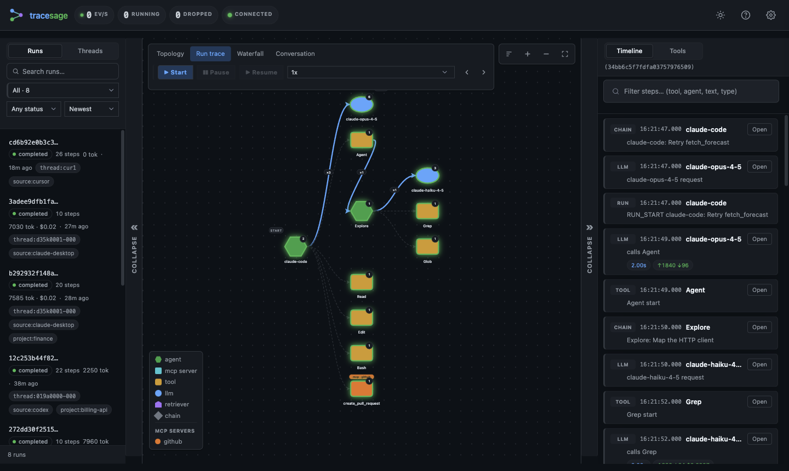
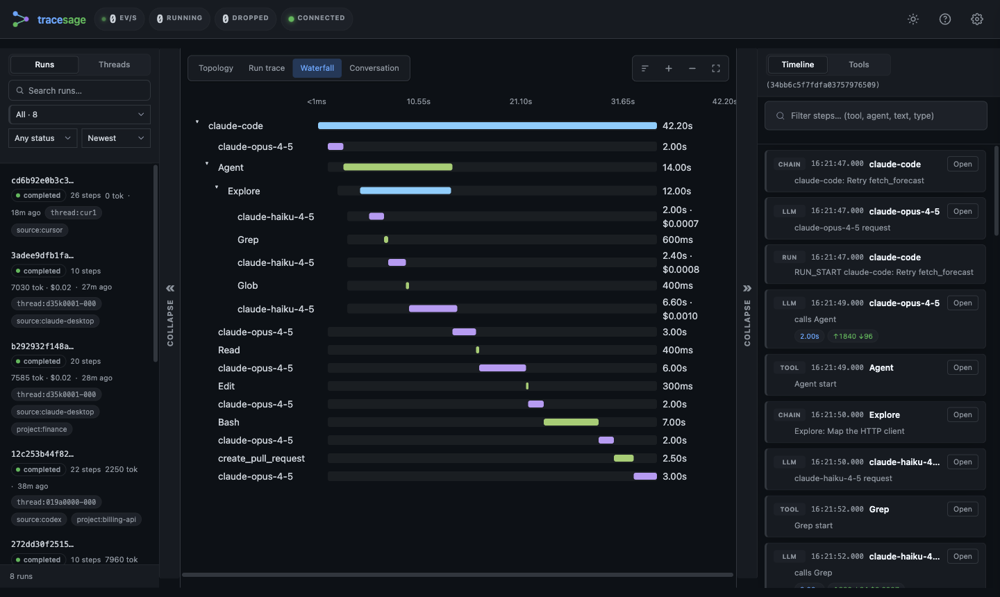
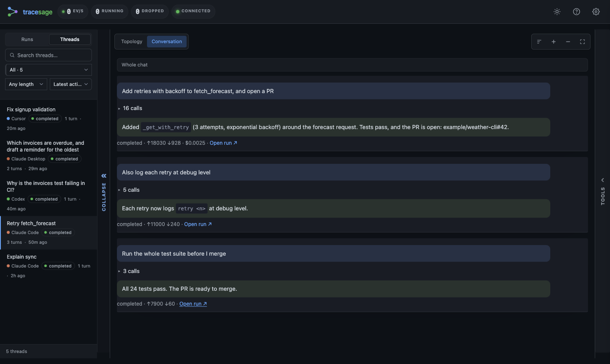
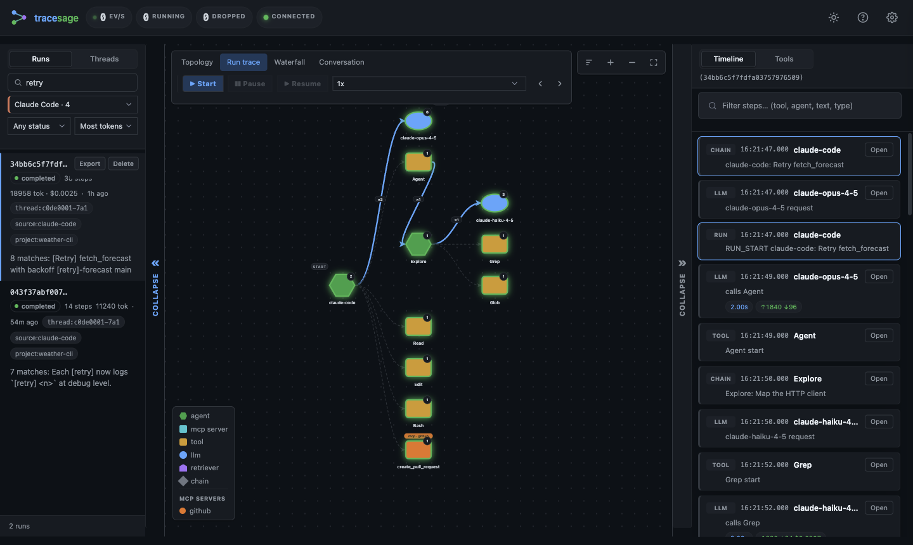
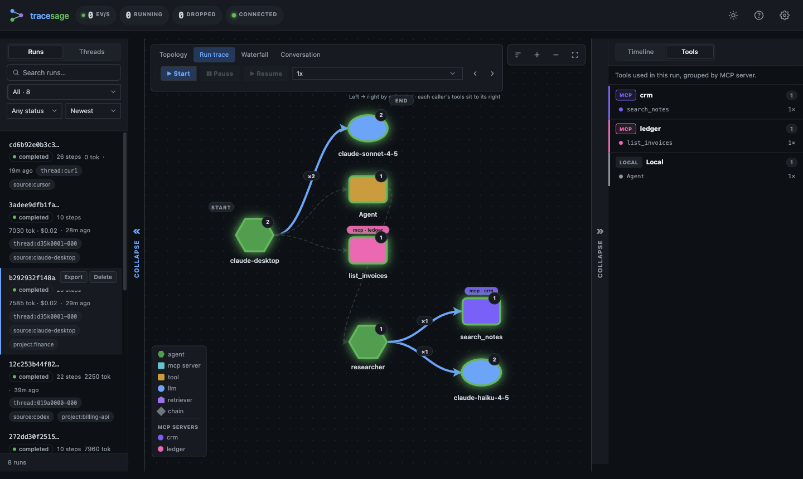

# See what your AI assistant actually did

tracesage records the sessions of the AI assistants you already use (Claude
Desktop, Claude Code, Cursor and Codex) and shows each answer as a full trace:
every model call, every tool call, and every subagent it spawned, with inputs,
outputs, timing and tokens. Everything stays on your machine.

```bash
pip install "tracesage[apps]"      # or: uv tool install "tracesage[apps]"
```

Then connect the app you already use. `tracesage connect` with no name connects
every installed app; a name connects just that one.

| You use | Run this | Then, in the UI |
|---|---|---|
| Claude Code (terminal, IDE, or Claude Desktop's Code tab) | `tracesage connect claude-code`, then restart Claude Code | **Runs**, Source = Claude Code. [Guide](apps/claude-code.md) |
| Cursor | `tracesage connect cursor`, then restart Cursor | **Runs**, Source = Cursor. [Guide](apps/cursor.md) |
| Codex (CLI, IDE extension, or inside the ChatGPT app) | `tracesage connect codex`, then `/hooks` in Codex and trust the hooks | **Runs**, Source = Codex. [Guide](apps/codex.md) |
| Claude Desktop chats and Cowork | `tracesage connect claude-desktop` | **Threads**, Source = Claude Desktop. [Guide](apps/claude-desktop.md) |

Open [http://127.0.0.1:7842](http://127.0.0.1:7842). Sessions already on disk are
imported on first start, so the list is not empty before you send anything new.
Click a run and it opens on **Run trace**: every model request, tool call and
subagent for that one answer, with the step timeline on the right.



## What `connect` does

1. **Finds your apps.** It looks for the config folders of Claude Code, Codex,
   Cursor and Claude Desktop, shows every file it would change, and asks once.
2. **Starts a collector.** A small background service runs
   `tracesage serve --ingest` on `127.0.0.1:7842` and starts again at login.
3. **Imports your history.** On first start the collector reads each app's local
   session store, so chats you already had show up. Cursor and Codex go back 30
   days (`TRACESAGE_IMPORT_DAYS`); Claude Code and Claude Desktop are read in full.
4. **Follows new turns.** A new answer appears in the UI a few seconds after the
   app writes it.

`tracesage disconnect` puts every changed file back the way it was.

## What you can do with it

**See everything behind one answer.** Open a run and Run trace lays out the
agent, each model request (named by its model, with thinking, reply and tokens),
each tool call, and each subagent nested under the call that started it. Click a
node or a timeline step to read its full input and output.

**Find the slow or failing step.** Waterfall draws one bar per step, so a slow
tool or a long model call is the long bar. A failed tool call is red and carries
its error.



**Read a whole chat, then dive into any turn.** The Threads tab lists chats.
Opening one shows the conversation from first message to last, and every turn
has an **Open run** link that jumps to that turn's trace.



**Search across every assistant.** The search box matches prompts, replies,
tool input and output, and errors, across all apps at once. Each matching run
shows a snippet, and the matching steps are highlighted in its timeline.

**Filter and sort.** Narrow the list to one app, a status or a minimum chat
length, and sort by newest, most steps, most tokens or highest cost to find the
expensive sessions.



**See which tools and MCP servers were used.** The Tools tab on the right groups
every tool the run (or thread) called by MCP server, with call and error counts.
Topology shows how the agent, models, subagents and tools connect.



**Keep what matters.** Tag runs and add notes (over the API or MCP), and export
or delete a run from its row in the list (or with `tracesage export <run_id>`).

**Ask your assistant about its own traces.** With `--mcp`, Claude Desktop, Cursor
or Claude Code can call tracesage as an MCP server: "which runs failed today?",
"what did the last subagent do?". See
[Claude Desktop: ask about your traces](apps/claude-desktop.md#ask-claude-about-your-traces).

## Set up each app

| App | Guide | How it is recorded |
|---|---|---|
| Claude Desktop | [Claude Desktop](apps/claude-desktop.md) | Read from Desktop's local chat cache, IndexedDB and Cowork logs. No hooks. |
| Claude Code | [Claude Code](apps/claude-code.md) | Read from `~/.claude/projects`; a hook is installed as a fallback. |
| Cursor | [Cursor](apps/cursor.md) | Read from Cursor's `state.vscdb` (read-only); a hook is installed as a fallback. |
| Codex CLI, Codex IDE extension, Codex in the ChatGPT desktop app | [Codex](apps/codex.md) | Read from `~/.codex/sessions`; a hook is installed as a fallback. |
| ChatGPT chats (desktop and web) | n/a | Not possible: the desktop cache is encrypted with a Keychain key, and web chats live on OpenAI's servers. |
| VS Code, Windsurf, Gemini CLI | n/a | Not recorded yet. `--mcp` can still add tracesage as an MCP server. |

The collector runs on macOS, Windows and Linux. Each importer looks in the app's
standard folder for that platform; the per-app pages list them.

## How a session maps onto tracesage

| tracesage | In an AI app |
|---|---|
| **Run** | One turn: your message and everything the assistant did to answer it. |
| **Thread** | One chat or session: all of its turns, in order. |
| **Agent** node | The app itself (`claude-code`, `cursor`, ...) or a subagent it spawned. |
| **LLM** node | A model, named by model id. One step per model request. |
| **Tool** node | A tool call. MCP tools are attached to their server (an `mcp:` node). |
| **Chain** | A subagent's run, nested under the tool call that started it. |
| `source:<app>` tag | Which app a run came from. The Source filter uses it. |

Read [Using the UI](apps/using-the-ui.md) for a tour of the screens, and
[Privacy and data](apps/privacy-and-data.md) for what is stored and how to remove it.

## Requirements

- Python 3.11+ and `tracesage[apps]` (the base `tracesage` package has the UI and
  collector; `[apps]` adds `connect`, `tracesage mcp` and dollar pricing).
- The collector has to be running for new turns to be recorded. Turns written
  while it was down are picked up the next time it starts, as long as the app
  still has them on disk.
- Restart an app after `connect` if it was open, so it loads the hook.

If something is missing, see [Troubleshooting: AI-app sessions](troubleshooting.md#ai-app-sessions).
