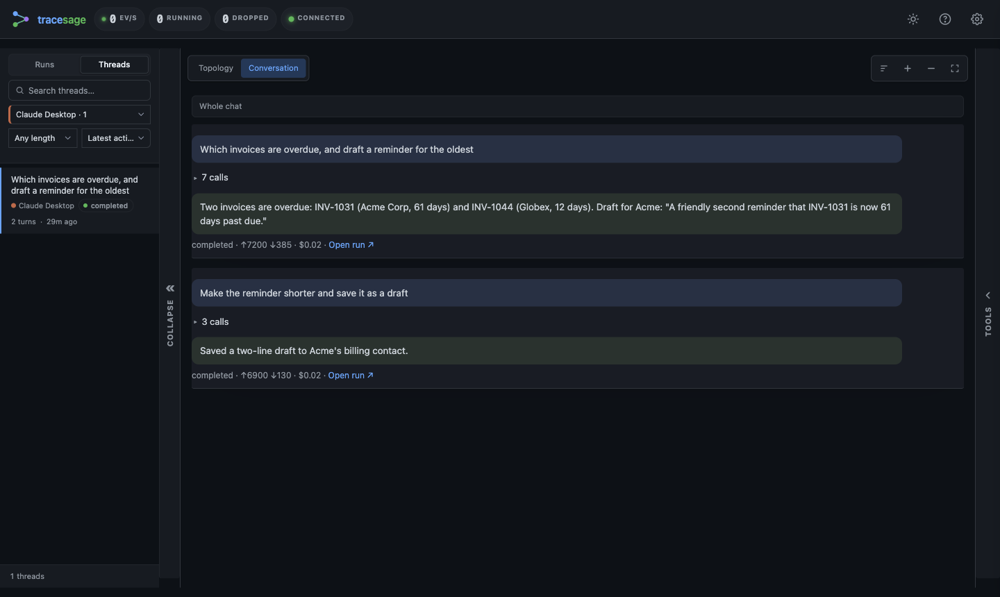

# Claude Desktop

Record your Claude Desktop chats and Cowork sessions as traces, then read them in
the tracesage UI or ask Claude about them over MCP. Nothing is installed into
Claude Desktop for recording: the collector reads files Desktop already keeps on
your machine.

## Connect it

**1. Install tracesage with the apps extra.**

```bash
uv tool install "tracesage[apps]"      # or: pip install "tracesage[apps]"
```

`uv tool install` puts `tracesage` in `~/.local/bin`. On macOS that matters if you
plan to use MCP (step 5): Claude Desktop is not allowed to run programs or read
files under `~/Documents`, `~/Desktop` or `~/Downloads`, so a virtualenv in a
project folder there will not work for it.

**2. Connect Claude Desktop.**

```bash
tracesage connect claude-desktop
```

This writes no config into Claude Desktop. It installs and starts the collector
(a login service on `127.0.0.1:7842`), and the collector starts reading Desktop's
local chat store. Running `tracesage connect` with no app name also covers
Claude Desktop, together with every other app it finds.

**3. Open the UI.** Go to [http://127.0.0.1:7842](http://127.0.0.1:7842), switch
to **Threads**, and set **Source** to Claude Desktop. Each sidebar chat is a
thread; each message you sent is a run.



**4. Open a turn.** Click **Open run** on any turn to see its trace: the model
request (with thinking and tokens when Desktop saved them) and each tool or MCP
call, with input and output. In Runs, a run opens on Run trace with the step
timeline on the right; **Show the whole chat** goes back to the conversation.

**5. Optional: let Claude query your traces.** See
[Ask Claude about your traces](#ask-claude-about-your-traces) below.

## What is recorded

| Desktop feature | Recorded | Where it is read from |
|---|---|---|
| Sidebar chats | Yes, if Desktop saved the transcript on this machine | Desktop's HTTP cache (`Cache/Cache_Data`) and the claude.ai IndexedDB |
| Cowork (agent mode) sessions | Yes, including subagents | `local-agent-mode-sessions/**/audit.jsonl` |
| Code tab | Recorded as Claude Code | It is Claude Code; run `tracesage connect claude-code` ([Claude Code](claude-code.md)) |
| MCP tool calls inside a chat or Cowork session | Yes, grouped under their MCP server | Same files as above |

A chat shows up once Desktop has written it to disk, which happens when you open
it. A chat you only ever used on the web or on another computer is not on this
machine, so it cannot be recorded until you open it here. Desktop chats are
imported in full on first start; there is no 30-day window.

The importer opens Desktop's files read-only and never changes them.

### Where Desktop keeps its files

| Platform | Folder |
|---|---|
| macOS | `~/Library/Application Support/Claude/` |
| Windows | `%APPDATA%\Claude\` |
| Linux | `~/.config/Claude/` |

## Ask Claude about your traces

With MCP enabled, Claude Desktop can call tracesage while you chat: "which runs
failed today?", "summarise thread X", "what did the last subagent do?", "tag this
run `regression`".

Pick one of the two setups.

**Config file (simplest).**

```bash
tracesage connect claude-desktop --mcp
```

This adds a `tracesage` entry under `mcpServers` in
`claude_desktop_config.json` (a backup is kept), pointing at `tracesage mcp`
with your data dir. Restart Claude Desktop to load it.

**Desktop extension (`.mcpb` bundle).**

```bash
tracesage connect claude-desktop --mcpb
```

This writes `tracesage.mcpb` into your data directory (default `~/.tracesage`).
It needs `npx`. Double-click the file, or drag it into Claude Desktop's
**Settings → Extensions**, then pick your data directory. The bundle runs the
MCP server with `uv`.

If `npx` is not installed, download the extension from the
[latest GitHub release](https://github.com/kjgpta/tracesage/releases/latest/download/tracesage.mcpb).

On macOS, keep both the `tracesage` program and the data dir outside
`~/Documents`, `~/Desktop` and `~/Downloads`. `connect` prints a warning when
either one is inside those folders.

### Tools Claude gets

| Tool | What it does |
|---|---|
| `list_runs` | Recent runs, filtered by status, text, thread or tag |
| `get_run` | Status, tokens, cost, tools, models and notes for one run |
| `get_run_spans` | The latency waterfall for one run |
| `get_step` | One step; the full payload only when asked |
| `search` | Full-text search over step text |
| `list_errors` | Recent failed runs |
| `list_threads`, `get_thread` | Chats and their turns |
| `get_stats`, `get_topology` | Totals, and how agents, models and tools connect |
| `compare_runs` | Two runs side by side |
| `add_note`, `set_tags` | Write a note or tags on a run |
| `delete_run` | Delete a run; needs `--allow-delete` and `confirm=true` |

Run the server with `tracesage mcp --read-only` to refuse every write, or with
`--allow-delete` to enable `delete_run`. Edit the `args` of the `tracesage` entry
in `claude_desktop_config.json` to add either flag. More in [MCP server](../mcp.md).

## Disconnect

```bash
tracesage disconnect claude-desktop
```

This restores `claude_desktop_config.json` from the backup `connect --mcp` made.
If the file did not exist before, there is no backup: delete the `tracesage`
entry under `mcpServers` by hand. Without `--mcp` there is nothing to restore.

Recording stops when the collector stops (`tracesage service stop`, or
`tracesage service uninstall` to remove it). To delete what was recorded, see
[Privacy and data](privacy-and-data.md).

## If something is missing

- **A chat is not in the list.** Open it once in Claude Desktop on this machine,
  then wait a few seconds.
- **No Claude Desktop runs at all.** Check `tracesage connect --status` and look
  for `Claude Desktop chats` in `~/.tracesage/logs/collector.log`.
- **The MCP server does not start (macOS).** Desktop cannot read the program or
  the data dir. Reinstall with `uv tool install "tracesage[apps]"` and rerun
  `tracesage connect claude-desktop --mcp`.

More in [Troubleshooting](../troubleshooting.md#ai-app-sessions).
