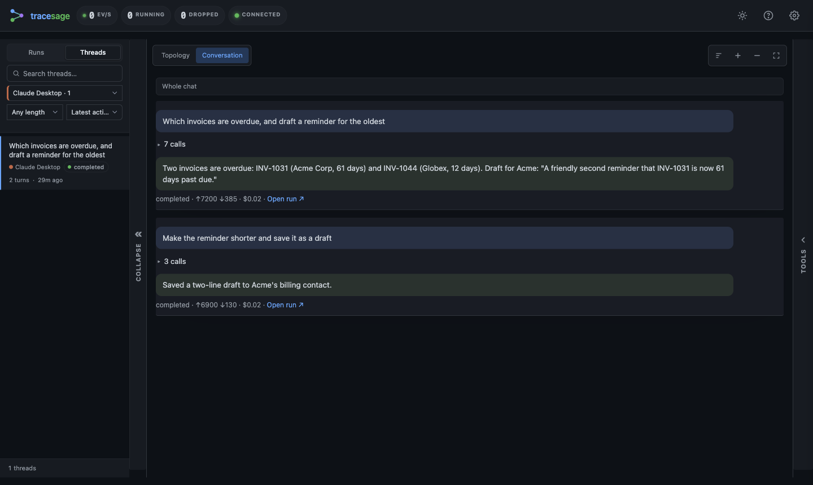
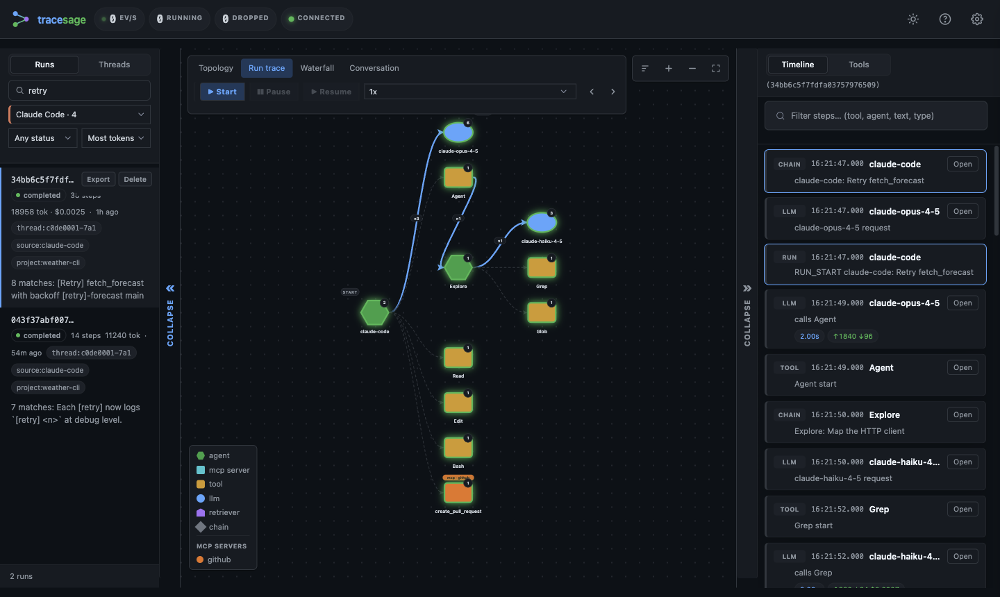
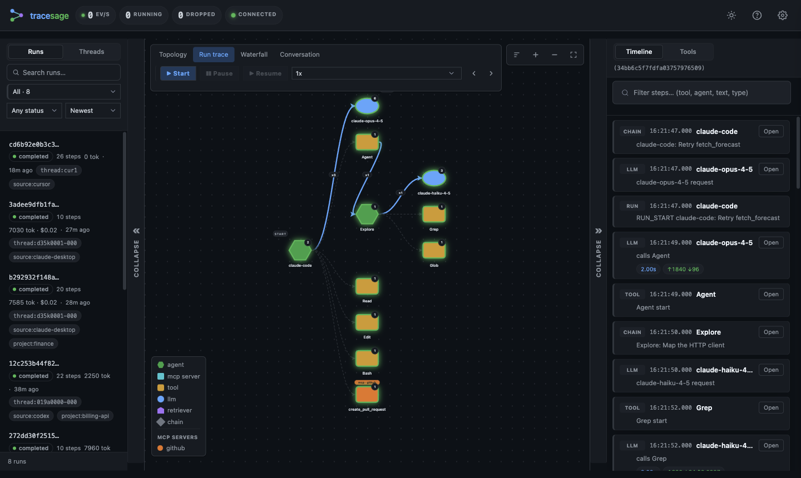
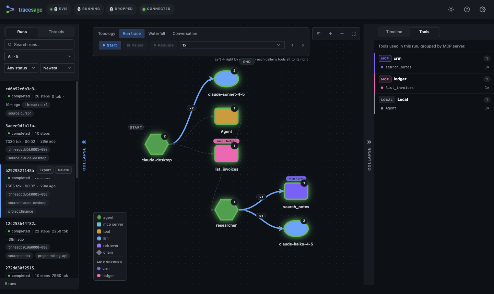

# Using the UI

The UI at [http://127.0.0.1:7842](http://127.0.0.1:7842) has three columns: the
list of runs or threads on the left, the selected item in the middle, and a side
panel on the right. This page walks through it with AI-app sessions in mind; the
same screens show runs from your own agents.

## Runs and Threads

The toggle at the top of the sidebar switches the list.

- **Runs** lists single turns, newest first. Opening one shows what the
  assistant did for that one message.
- **Threads** lists whole chats. Opening one shows the conversation from the
  first message to the last.

Threads mode only shows the conversation. A chat can hold hundreds of turns, so a
combined trace or waterfall for it would be hard to read and easy to misread;
open a single turn instead. Each turn in a thread has an **Open run ↗** link that
switches to Runs and opens that turn.

While a new run or thread loads, the middle column shows a spinner rather than
the item you had open before.

## Search and filters

The search box at the top of the sidebar (press `/` to focus it) matches prompts,
replies, tool input and output, and errors across every app. In Runs, each
matching run shows how many steps matched and a snippet, and the matching steps
are highlighted in its timeline. In Threads it matches thread ids and the text of
any turn.

Under the search box are filters for the current tab. Each tab keeps its own.

| Filter | Runs | Threads |
|---|---|---|
| Source | All sources, Claude Code, Claude Desktop, Cursor, Codex, or Your agents (runs not from an AI app) | Same |
| Status | Any, Running, Completed, Failed, Interrupted | n/a |
| Length | n/a | Any length, 2+, 5+ or 20+ turns |
| Sort | Newest, Oldest, Most steps, Most tokens, Highest cost | Latest activity, Oldest activity, Most turns, Most tokens |

Each source shows its count. The list holds the first 200 matches and its footer
says how many there are in total; narrow the filters or search to reach older ones.

## Reading one run

A run opens on **Run trace**, with the **Timeline** on the right.

- **Run trace** draws the turn as a tree: the app's agent node, each model
  request, each tool call, and each subagent under the call that started it.
  Click a node to open its details.
- **Timeline** lists the same steps in order with their duration. Click one to
  open the step drawer with the full input and output, tokens and cost.
- **Waterfall** shows each step as a bar on a time axis, so the slowest step is
  the longest bar.
- **Conversation** shows the turn as chat messages, with a
  **Show the whole chat** link that opens the full thread.
- **Topology** aggregates how agents, models and tools connect for this run, the
  last N runs, or all time.

## The Tools tab

The right panel has two tabs: **Timeline** and **Tools**. Tools groups every tool
the open run used by MCP server (built-in tools are grouped as Local) with how many
times each was called and how many calls failed. In Threads mode it covers the
whole chat.

## Resizing and collapsing

- Drag the edge between two columns to resize the sidebar or the right panel.
  Double-click the edge to reset it, or focus it and use the arrow keys. Widths
  are remembered.
- **Collapse** hides a side column; the button left on the edge brings it back.
  In Threads mode the right panel starts collapsed.

## Keyboard shortcuts

| Key | Action |
|---|---|
| `j` / `k` | Next / previous run |
| `/` | Focus search |
| `t` | Toggle light and dark theme |
| `Esc` | Close the step drawer or a dialog |
| `?` | Show the shortcuts |

## Tags, notes and export

A run's tags show in the list and on the run; `source:<app>` marks AI-app runs.
Notes show in the run's timeline. Add tags and notes over the API
(`PATCH /api/runs/{id}/tags`, `POST /api/runs/{id}/notes`) or from an assistant
over MCP (`set_tags`, `add_note`).

Hover over a run in the list for its **Export** button (downloads the run as
JSONL, like `tracesage export <run_id>`) and its **Delete** button.

If the collector has an auth token, the UI asks for it once in **Settings**.
