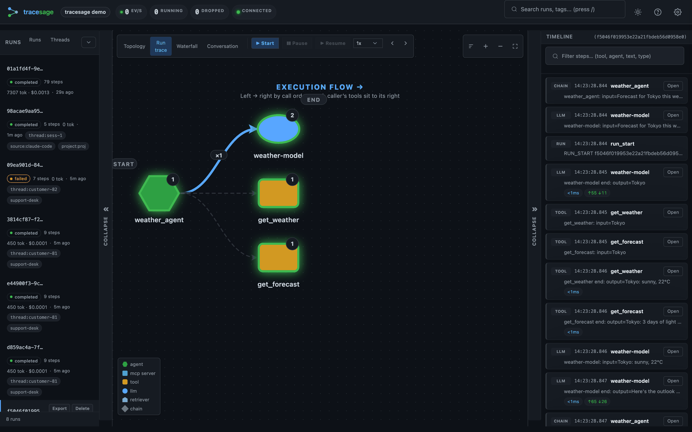
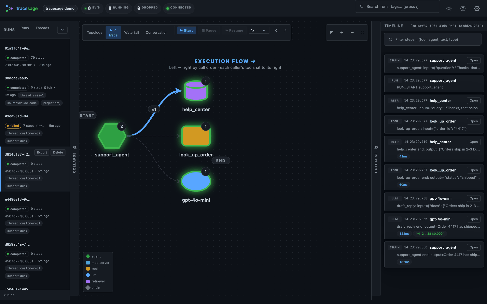

# Frameworks: Pydantic AI, OpenAI Agents SDK, CrewAI, OpenAI, Anthropic, anything OpenTelemetry

tracesage started as a LangChain / LangGraph callback handler. It now also accepts
**OpenTelemetry spans**, which is how every other major agent framework reports what
it did. Whatever produces OTel spans can show up in the tracesage UI, CLI and pytest
fixture — the same topology graph, timeline, token counts and red-node-on-failure.

There are three ways in, from least to most code:

| Way in | When to use it | Needs |
|---|---|---|
| [`tracesage.instrument(...)`](#1-instrument-one-line-in-process) | The framework runs in the same Python process as tracesage (the common case) | `pip install "tracesage[<framework>]"` |
| [`tracesage serve --ingest`](#2-serve-ingest-a-standalone-otlp-collector) | The agent is another process, another language, or already exports OTLP | nothing extra in the producer; `tracesage[otel]` on the collector for protobuf |
| [`tl.span(...)` / `@tl.trace_fn`](#3-manual-spans-trace-your-own-code) | Plain Python with no framework, or wrapping the code *around* an agent call | nothing |

LangChain / LangGraph keep working exactly as before; the callback handler is unchanged
and LangChain roots nest under an active manual span automatically.

---

## 1. `instrument(...)`: one line, in-process

```bash
pip install "tracesage[pydantic-ai]"        # also: openai-agents, crewai, openai, anthropic
```

```python
import tracesage
from pydantic_ai import Agent

agent = Agent("openai:gpt-4o", instructions="Be concise.")

with tracesage.trace(instrument=["pydantic_ai"]):
    agent.run_sync("What's the weather in Paris?")
# 🔍 tracesage: http://127.0.0.1:7842/ui/#/runs/<trace-id>
```

`instrument=` is accepted by `tracesage.trace()`, `tracesage.start()` and
`TraceSage.session()`. The equivalent explicit call is `tracesage.instrument("pydantic_ai", tracer=tl)`
or `tl.instrument("pydantic_ai")`, and it returns the OTel `TracerProvider` so you can add
your own spans with `provider.get_tracer(__name__)`.

What happens: tracesage creates (or reuses) an OpenTelemetry `TracerProvider`, attaches a
`TraceSageSpanExporter` to it, and switches on the framework's instrumentor against that
provider. Spans are translated to tracesage events in-process — nothing goes over the
network, and the exporter never raises (a bad span is logged and dropped; your agent
keeps running).

| Name | Framework | What is installed / enabled |
|---|---|---|
| `pydantic_ai` | [Pydantic AI](https://ai.pydantic.dev/) | `Agent.instrument_all(InstrumentationSettings(tracer_provider=...))` — Pydantic AI emits GenAI-semconv spans natively |
| `openai_agents` | [OpenAI Agents SDK](https://openai.github.io/openai-agents-python/) | `opentelemetry-instrumentation-genai-openai-agents` (workflow / agent / tool spans; also disables export to OpenAI's trace dashboard) plus the OpenAI client instrumentation for the `chat` spans underneath |
| `crewai` | [CrewAI](https://www.crewai.com/) | `openinference-instrumentation-crewai` (Crew / Task / Agent / Tool spans, OpenInference conventions) and `CREWAI_DISABLE_TELEMETRY=true` |
| `openai` | `openai` Python client | `opentelemetry-instrumentation-genai-openai` — `chat {model}` spans with tokens and messages |
| `anthropic` | `anthropic` Python client | `opentelemetry-instrumentation-genai-anthropic` — `chat {model}` spans with tokens and messages |

Several at once: `instrument=["openai_agents", "anthropic"]`.

The extras pull the OTel SDK and the instrumentor only; **the framework itself is not
pinned** — install whichever version your app already uses. A missing package raises
`ImportError` with the exact `pip install` line.

### Prompts and completions

The GenAI instrumentations (OpenAI, Anthropic, OpenAI Agents) record message content
only when `OTEL_INSTRUMENTATION_GENAI_CAPTURE_MESSAGE_CONTENT` is set. tracesage exists to
show you those, so `instrument()` defaults it to `span_only` if you have not set it. Set it
to `no_content` yourself to keep prompts out of the trace; `redact_patterns` applies to
whatever is captured, as it does for LangChain.

### Already using OpenTelemetry?

If your process has a global `TracerProvider` from the OTel SDK (you configured one for
Tempo / Honeycomb / Phoenix), `instrument()` and `install_otel()` **add** the tracesage
exporter to it instead of replacing it. Your existing exporter keeps shipping spans; the
same spans also land in tracesage. Pass `set_global=False` to keep the tracesage provider
private.

Conversely, if you also set `otlp_endpoint` so tracesage *exports* to a collector, spans
that *arrived* as OTel are not exported again — so pointing `otlp_endpoint` at a
collector that feeds `tracesage serve --ingest` cannot loop.

---

## 2. `serve --ingest`: a standalone OTLP collector

For agents that run in another process (or Node, or Go), or an app that already speaks
OTLP, run tracesage as a collector:

```bash
pip install "tracesage[otel]"               # protobuf decoding; OTLP/JSON works without it
tracesage serve --ingest -d ~/.tracesage --open
# tracesage collector at http://127.0.0.1:7842/ui  (data: ~/.tracesage)
#   OTLP/HTTP ingest: POST http://127.0.0.1:7842/v1/traces
```

Then point any OpenTelemetry exporter at it — the standard environment variables are enough:

```bash
export OTEL_EXPORTER_OTLP_ENDPOINT=http://127.0.0.1:7842
export OTEL_EXPORTER_OTLP_PROTOCOL=http/protobuf              # or http/json
export OTEL_SERVICE_NAME=weather-app                           # becomes a run tag
python my_agent.py
```

```python
# or in code
from opentelemetry.sdk.trace import TracerProvider
from opentelemetry.sdk.trace.export import BatchSpanProcessor
from opentelemetry.exporter.otlp.proto.http.trace_exporter import OTLPSpanExporter

provider = TracerProvider()
provider.add_span_processor(BatchSpanProcessor(OTLPSpanExporter(endpoint="http://127.0.0.1:7842/v1/traces")))
```

The embedded server inside your own process also exposes `/v1/traces` (config
`ingest=True`, the default), so a second process can post into a running
`tracesage.trace()` session.

`POST /v1/traces` accepts `application/x-protobuf` (the OTLP default) and
`application/json`, optionally `Content-Encoding: gzip` or `deflate`, up to
`ingest_max_body_bytes` (16 MiB). With `auth_token` set, send
`OTEL_EXPORTER_OTLP_HEADERS="Authorization=Bearer%20<token>"`. The full response contract
(partial success, 400 / 413 / 415 / 501) is in [API → `POST /v1/traces`](api.md#post-v1traces).

Ingest goes through the **same pipeline** as in-process tracing: sampling, the per-run
event cap, redaction, the worker and (if configured) OTel export all apply. Live updates
reach the UI over the same WebSocket.



---

## 3. Manual spans: trace your own code

No framework? Wrap the code you care about:

```python
import tracesage

with tracesage.trace() as tl:
    with tl.span("research pipeline", kind="agent", inputs={"topic": "solar"}) as root:
        with tl.span("fetch sources", kind="tool", tool_name="web_search") as s:
            docs = search("solar")
            s.set_output(docs)
        with tl.span("summarise", kind="llm", model="gpt-4o") as llm:
            text = call_llm(docs)
            llm.set_output(text).set_tokens(input=1200, output=180)
        root.set_output(text)
```

- `kind` is one of `chain` (default), `agent`, `tool`, `llm`, `retriever` — the same
  five [topology node kinds](concepts.md) LangChain spans map to.
- Spans nest by Python context (a `contextvars.ContextVar`), so they work across
  `await`, threads started with `contextvars.copy_context()`, and concurrent tasks.
  `async with tl.span(...)` is supported.
- An exception inside the block records an error event (`error_message`, type and
  traceback in the payload), marks the span's run as failed, and **re-raises** — tracesage
  never swallows your exceptions.
- `thread_id=` groups spans into a conversation; children inherit it.
- The decorator form captures arguments as inputs and the return value as output:

```python
@tl.trace_fn(kind="tool", tool_name="lookup")
def lookup(order_id: str) -> dict: ...

@tl.trace_fn(kind="agent")
async def plan(goal: str) -> str: ...
```

- A LangChain / LangGraph call made inside a manual span becomes a child of that span
  (its root callbacks adopt the active manual span as parent), so you can wrap the
  request handler around an agent invocation and see both in one trace.
- With `enabled=False`, `tl.span()` returns an inert span and `trace_fn` returns the
  function unchanged — the same zero-cost kill switch as the rest of tracesage.

`tracesage.current_span()` returns the active manual `Span` (or `None`).



---

## How OTel spans become tracesage runs

| OpenTelemetry | tracesage |
|---|---|
| `trace_id` | `root_run_id`, and the run you see in the run list |
| `span_id` / `parent_span_id` | `run_id` / `parent_run_id` (a root span's parent is the trace) |
| `service.name` | run tag (alongside `otlp`) |
| span start / end / status | `*_start` + `*_end` (or `*_error`) events with duration; a failed root span fails the run |
| `gen_ai.usage.input_tokens` / `output_tokens` (or OpenInference `llm.token_count.*`) | token counts on the LLM step and the run |
| `gen_ai.conversation.id` / `session.id` | `thread_id` |
| `gen_ai.input.messages` / `output.messages`, OpenInference `llm.input_messages.*`, `input.value` / `output.value`, tool arguments / result | request / response payloads and the step summary |
| `mcp.server.name` (or `server.address` on a `tools/call`) | MCP server attribution, as for LangChain MCP tools |
| every attribute, event and resource | kept verbatim in the step payload (`attributes`, `events`, `resource`) |

Node kind is decided in this order: `gen_ai.operation.name` (`chat`, `invoke_agent`,
`execute_tool`, `embeddings`, `retrieval`, …) → `openinference.span.kind` (`LLM`, `AGENT`,
`TOOL`, `RETRIEVER`, `CHAIN`) → span-name prefix (`chat gpt-4o`, `execute_tool x`,
`invoke_agent y`) → "has a model and token counts" → `chain` named after the span. So a
span from an instrumentation tracesage has never seen still lands in the right place as
long as it follows the GenAI or OpenInference conventions, and otherwise shows up as a
chain with its attributes intact.

Event ids are deterministic (`<span_id>-start` / `-end`), so a retried OTLP batch is
idempotent: re-sent spans overwrite themselves instead of duplicating steps.

---

## Examples

[`examples/frameworks/`](https://github.com/kjgpta/tracesage/tree/main/examples/frameworks)
has one runnable script per framework. `pydantic_ai_agent.py` uses Pydantic AI's
`TestModel`, so it runs with **no API key** — the quickest way to see a non-LangChain
trace:

```bash
pip install "tracesage[pydantic-ai]" pydantic-ai-slim
python examples/frameworks/pydantic_ai_agent.py
```
